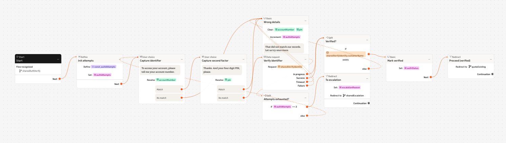

# Customer Experience (CX) Design Agent

### From a business process to a live conversational AI agent on Amazon Connect.


The **Customer Experience (CX) Design Agent** is an Amazon CX domain expert that runs inside your IDE. Start from
whatever you have: a business process or standard operating procedure (SoP), a set of user stories, or a plain
business or technical description of the experience you want. It takes you through discovery, design, build and deployment of a working conversational AI solution on
**Amazon Connect Agentic CX Designer (ACXD)**.

You set the direction and approve each step. The agent produces the scoping, the design, the deployable code and
the runbook. It is built on the
**[AI-Driven Development Lifecycle (AI-DLC)](https://aws.amazon.com/blogs/devops/ai-driven-development-life-cycle/)**,
so every decision passes a human gate and lands as a reviewable document.

> **Prefer a guided path?** The workshop
> **[Customer Experience (CX) Design Agent: From Business Process to Live Conversational CX Agent](https://catalog.us-east-1.prod.workshops.aws/workshops/f130d600-59f4-4059-9eae-4573648d06a2/)**
> walks you step by step through installing the agent, running an engagement on a sample business process, and
> deploying and testing the result. This repository is for those who want to install and run the agent directly.

## What you get

- **Agreed scope, fast.** A guided discovery session turns your process, stories or idea into approved user
  stories and a consolidated scoping document for business sign-off. No SoP? The agent asks the questions.
- **A designed and tested conversation.** Flows, journeys and integrations, checked against every user story
  before anything is deployed.
- **No waiting for data access.** Mock APIs, synthetic data and a synthetic knowledge base let you build and test
  end to end from day one. Swap in your live systems later without redesigning.
- **Deployable code and a runbook.** The ACXD solution, the backend and the Amazon Connect integration, with a
  step-by-step runbook.



## Example outputs

[`docs/example-outputs/`](docs/example-outputs/) holds a complete set of documents from the AnyCare Insurance example
(the same use case the workshop runs): the input SoP and the three documents the agent generated from it.

| File | What it is |
| --- | --- |
| [AnyCare Insurance SoP](docs/example-outputs/any-care-insurance-sop.pdf) | **Input.** The fictitious standard operating procedure for insurance quotes that the agent starts from |
| [Consolidated scoping document](docs/example-outputs/anycare-insurance-consolidated-scoping.pdf) | **Scoping phase output.** Discovery findings, SoP deconstruction, user stories and scope, for business sign-off |
| [Architecture document](docs/example-outputs/anycare-insurance-architecture-document.pdf) | **Design and build output.** Flows, integrations, resources, test results and the path to production |
| [Deployment runbook](docs/example-outputs/anycare-insurance-consolidated-runbook.pdf) | **Deployment guide.** Step-by-step commands to deploy the mock APIs, the ACXD solution and the Amazon Connect integration |

## Get started

1. **Install** the agent in Kiro IDE: follow **[Getting started](docs/guide/getting-started.md)** (about 15 minutes).
2. **Start an engagement** in the Kiro chat panel:
   ```
   /aidlc --scope acxd-platform-poc
   ```
3. **Tell it what you want to build.** Describe your use case in the chat, or add an SoP, user stories or any
   requirements notes to `customer-context/`, then answer the agent's questions. Nothing to share yet? Just
   describe the idea; the agent works out the rest with you.

You need a Kiro Pro subscription, an AWS account in an ACXD-supported region, and an existing Amazon Connect
instance; see [Setting up](docs/guide/setting-up.md). Run it in Kiro Supervised mode when AWS credentials are
present; see [Security](docs/guide/security.md).

## Documentation

The full guide lives in [`docs/guide/`](docs/guide/index.md).

**User guide**

| Page | What it covers |
|---|---|
| [What is the CX Design Agent?](docs/guide/what-is-cx-design-agent.md) | What the agent does and what you get |
| [How it works](docs/guide/how-it-works.md) | The plugin, the AI-DLC lifecycle, the stages and what each produces |
| [Concepts](docs/guide/concepts.md) | The Agentic Design Principle, the deterministic core, systems integration testing, mock APIs |
| [Setting up](docs/guide/setting-up.md) | Prerequisites and dependencies |
| [Getting started](docs/guide/getting-started.md) | Install the agent in Kiro IDE and start an engagement |
| [Security](docs/guide/security.md) | Running the agent safely with AWS credentials present |
| [Engagement scopes](docs/guide/scopes.md) | The five scopes and how to choose one |
| [Deploying the solution](docs/guide/deploying.md) | The three deployable code sets and the runbook stages |

**Developer guide**

| Page | What it covers |
|---|---|
| [Authoring flows with FlowSpec](docs/guide/dev-authoring-flows.md) | How flows are specified, built and checked |
| [The ACXD deploy engine](docs/guide/dev-deploy-engine.md) | The `.env` contract, the deploy config and orchestration order |
| [Knowledge and provenance](docs/guide/dev-knowledge.md) | The knowledge tiers, load order and source tags |
| [Developing the plugin](docs/guide/dev-developing-the-plugin.md) | Repository layout, development loop, tests, extending, developer mode |

See also [CONTRIBUTING.md](CONTRIBUTING.md) and [SECURITY.md](SECURITY.md).

## License

Licensed under the [Apache License 2.0](LICENSE). Third-party components keep their own licenses; see
[NOTICE](NOTICE) and [THIRD-PARTY-LICENSES.md](THIRD-PARTY-LICENSES.md).
