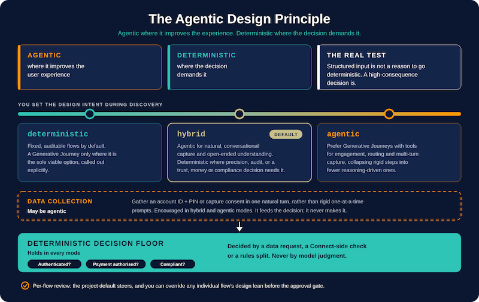
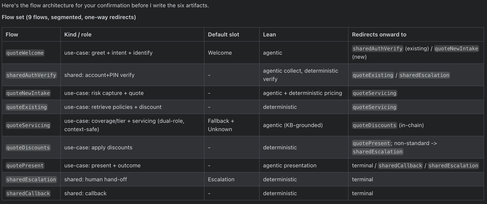
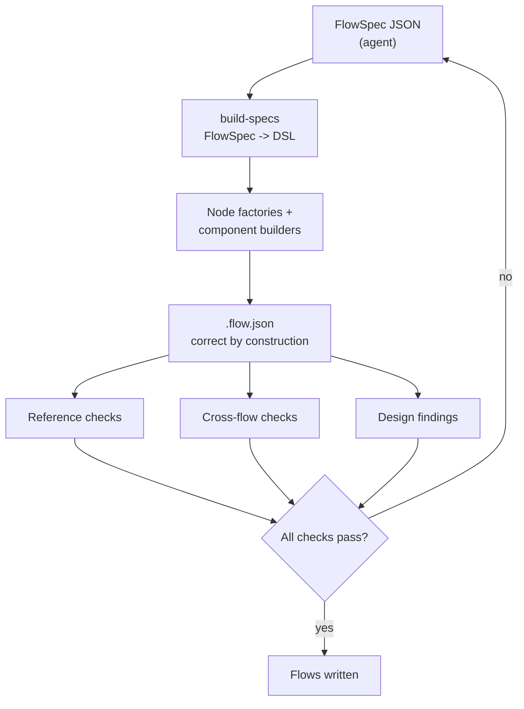
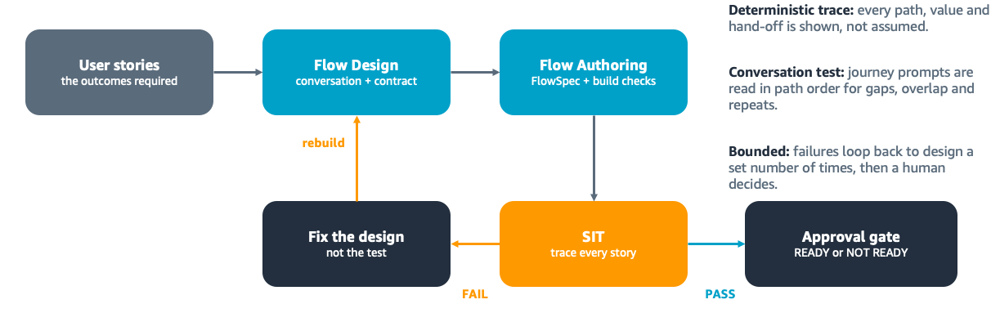
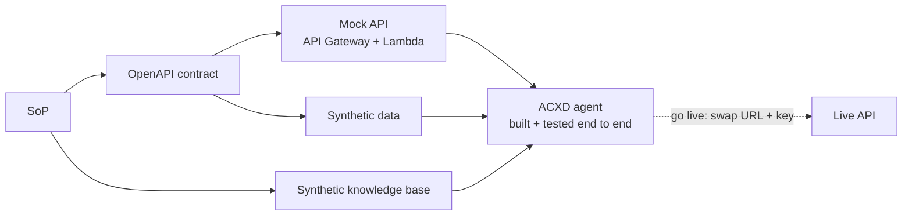

# CX Design Agent concepts

## The Agentic Design Principle

How agentic or deterministic the solution is, is a choice you make at discovery and can tune per flow before the
design gate:

- **Agentic** where it improves the customer experience.
- **Deterministic** where the decision demands it.
- Structured input is **not** a reason to go deterministic; a **high-consequence decision** is.

One setting steers it: `deterministic`, `hybrid` (the default) or `agentic`. In every mode a **deterministic
decision floor** holds: the verdict on a high-consequence step (authenticated? price? eligible?) always comes from a
data request and a rules split, never from model judgement. Collecting the input that feeds the decision can be
agentic, and in hybrid and agentic modes a natural, one-turn capture is encouraged.

Inside a flow, the design aims for **one conversation**: a use case stays in one flow unless a part passes a
flow test (for example, escalation is reached from several places), and it uses as few Generative Journeys as its
reasons allow, so the customer never notices a hand-over.

## The deterministic core

An AI model is good at open-ended work and poor at exacting work: a byte-correct node graph, an undocumented wire
field, the same API calls in the same order every time. The agent therefore authors **declarative inputs** for
deterministic tools rather than performing the exacting work itself.

| Building block | What the agent writes | What the tool guarantees |
|---|---|---|
| **FlowSpec** | One JSON spec per flow: nodes, settings and where each exit goes | A declarative, reviewable flow definition |
| **Flow DSL** (node factories, component builders) | Nothing directly; FlowSpec calls it | Correct-by-construction flow graphs: exits derived from config, every exit wired, verified wire shapes |
| **Validators** | Nothing | Reference checks (tokens, slots, data requests, types, names), cross-flow checks (setters, reachability, identity after sign-in) and blocking design findings (dead data, dead state, split conversations, thin journey prompts) |
| **Deploy engine** | Declarative resource JSON and `acxd-deploy.config.json` | Workspace, resources, flows and application created in the right order, the same way, every time, validated before any AWS call |

| Critical question | Without the core | With it |
|---|---|---|
| Is the flow graph valid? | The model writes JSON; errors appear at deploy or run time | Invalid graphs cannot be built |
| Is each node's wire shape right? | The model recalls an undocumented format per node | One verified factory owns each shape |
| Are resources created in the right order, the same way? | Scripts drift per run | A fixed engine with the same order, timing and idempotency every run |
| Who makes a high-consequence decision? | Possibly the model | A deterministic decision floor |

Platform behaviours that contradict intuition (for example, data-request exits bind by position, not by condition)
are recorded in `knowledge/acxd-platform-agent/acxd-counter-intuitive-patterns.md`, each with what enforces it.

## Systems integration testing

A clean build proves the flows are well formed, not that they deliver the user stories. Two tests, run inside the
stages, close that gap:

- **Architecture SIT** (end of Flow Design, before anything is built): six tests on the design: flow boundaries,
  fewest journeys, one conversation, data requests in order, deterministic decisions, every story delivered.
- **Build SIT** (Flow Authoring, on the built flows): scenarios written from each story are run through a
  deterministic **tracer** over the real `.flow.json`, and every acceptance criterion is judged from the trace. A
  conversation narrative test reads each path's journey prompts together for gaps, overlap and repeats.

Both tests return **READY** or **NOT READY**, with a verdict line in a fixed format. Each verdict is PASS, FAIL, or
DEFERRED / NOT TRACED for what only a live test can show (wording, guardrails, voice), which becomes the **live test
list**. Failures loop back to fix the design, a bounded number of times, then a human decides at the gate. A fix that
would change the flow structure is reported as an architecture fault for Flow Design, not patched in the build.

## Mock APIs and synthetic knowledge

Every integration starts as an **OpenAPI contract**: yours, or one the agent writes from the SoP. The agent then
generates and deploys:

- a **mock API per OpenAPI file** (its own API Gateway and Lambda, one route per operation) serving **synthetic
  records**, all deployed together as nested stacks of one CDK stack, and
- a **synthetic knowledge base** of policy or product documents, loaded and published by the deploy engine.

The ACXD solution is built and tested end to end against them from day one, while data-access and security approvals
run in parallel. Going live swaps the URL and key for the real API: the same contract and the same flows.

---

[Documentation home](index.md)
