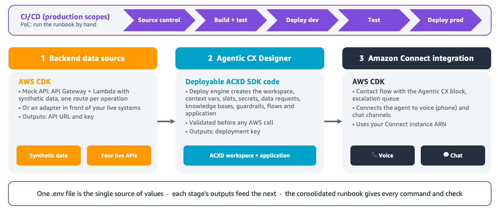

# Deploying the solution

The agent produces **three deployable code sets** and one runbook. Deployment is always a human step: the agent
builds the code but never deploys it.

1. **Backend data source** (AWS CDK): the mock APIs (one nested stack per API, deployed with one command), or an
   adapter in front of live systems. Outputs each API's URL; each API key is generated into `.env` beforehand.
2. **ACXD solution** (deploy engine on the ACXD SDK): workspace, resources, flows and application, validated before
   any AWS call. You then review, build and deploy in the ACXD console, which gives the deployment key.
3. **Amazon Connect integration** (AWS CDK): the contact flow with the Agentic CX block and the escalation queue, into
   your existing Connect instance.

One `.env` file holds every value, and each stage's outputs feed the next. The API wiring tool derives each API's
`.env` entries, ACXD secrets and data-request URLs from its OpenAPI file. CDK bootstrap is a one-time prerequisite
step in the runbook, not part of any stage. In production scopes the same three stages
run in a CI/CD pipeline across dev, test and prod.

## The runbook stages

The generated runbook is the deployment guide for your solution. It runs in this order:

1. **Prerequisites.** Set the region, project and Connect instance ARN in `.env`, generate the ACXD API key in the
   ACXD Admin Hub, check your AWS access, and bootstrap CDK once for the account and region.
2. **Stage 1, Backend.** Deploy the mock APIs (or adapter) with `npm run deploy`, copy each `<ApiId>Url` output into
   `.env`, and smoke-test each API.
3. **Stage 2, ACXD SDK.** Run the deploy engine to create the workspace, resources, flows and application, then build
   and deploy in the ACXD console and save the deployment key.
4. **Stage 3, Amazon Connect.** Deploy the Connect integration stack into your existing instance.

## Platform notes

- **Authentication:** ACXD uses API keys (not IAM/SigV4), created for programmatic users in the Admin Hub.
- **Build and deploy:** asynchronous, and a manual review step in the ACXD console. The deploy engine stops after
  creating the application.
- **Analytics:** the built-in ACXD analytics dashboard, driven by analytics tags on flow nodes.
- **Voice:** set in the Amazon Connect contact flow, not in ACXD.
- **Naming:** ACXD identifiers are camelCase; flows and resources are named for their use case.
- **SDK:** all automation uses the GA `amazon-connect-acxd-sdk` package, pinned in
  `tools/acxd-deploy-engine/package.json`.

---

[Documentation home](index.md)
