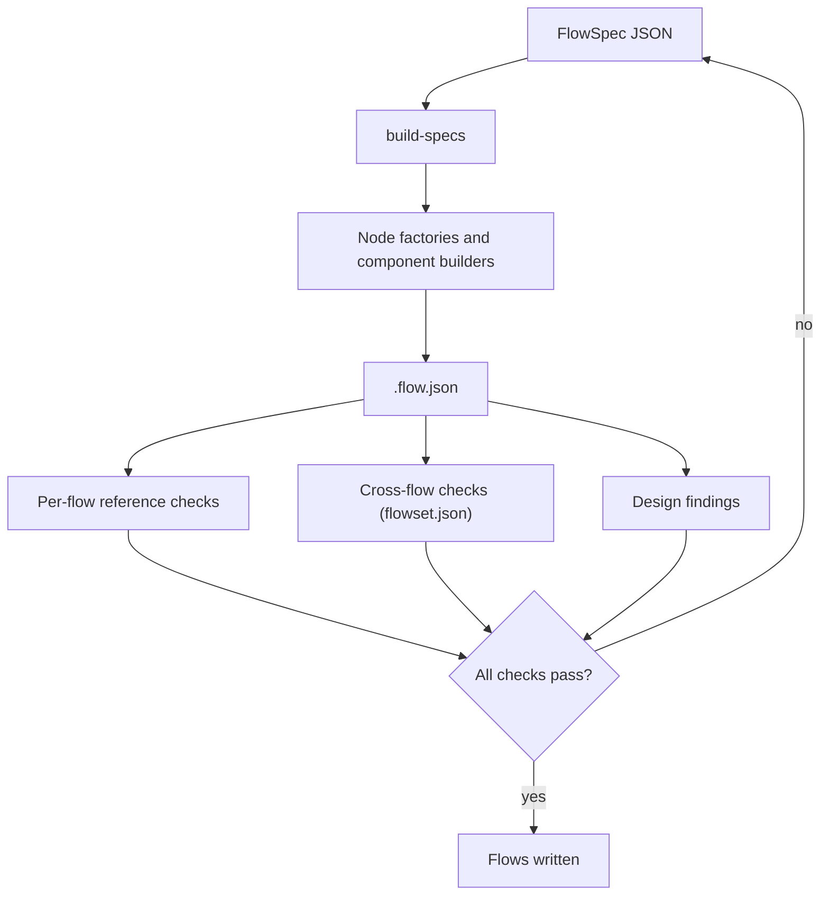

# Authoring flows with FlowSpec

The agent authors each flow as a **FlowSpec**: one JSON file per flow that lists its nodes, their settings and where
each exit goes. FlowSpec is data, not code. The build tool turns every spec into the verified console wire format by
calling the same typed node factories and component builders a TypeScript script would, then runs the per-flow and
cross-flow checks. The agent never hand-writes `.flow.json`.

The full format reference (node types and their exits, reference forms, state changes, split conditions, typed
values, component specs, `flowset.json` options and every design finding) is
[`tools/acxd-deploy-engine/flow-dsl/FLOWSPEC.md`](../../tools/acxd-deploy-engine/flow-dsl/FLOWSPEC.md). It is the
single home for the format; this page explains how the pieces fit together.

## Build

```bash
npx --yes tsx {{HARNESS_DIR}}/tools/acxd-deploy-engine/flow-dsl/build-specs.ts <flowsDir>
```

The build reads `<flowsDir>/specs/*.flowspec.json` and the optional `<flowsDir>/flowset.json`, builds every spec,
runs the checks, and writes `<flowsDir>/<flowId>.flow.json` only if every check passes. Any failure lists every
problem with the fix.

## Two spec forms

- **Component:** a whole flow built by a component builder (escalation, callback, FAQ lookup and the others in
  `flow-dsl/DESIGN.md`), with all domain wording passed as parameters. Used for flows that are separate by design,
  such as escalation.
- **Nodes:** a bespoke flow authored node by node. The use-case flow is authored this way.

## What the build checks



- **Per-flow reference checks** (`lib/validate-flow-refs.ts`): tokens, slots, data requests, typed operands, names,
  exit order and wiring. Every `user_choice` must carry a message.
- **Cross-flow checks** (`lib/flowset-checks.ts`): every context variable read has a setter on every redirect path,
  identity values are set only after sign-in (`authFlagVar`), redirect targets exist, and declared terminal sinks
  never redirect onward.
- **Design findings** (`lib/flowset-warnings.ts`): dead data, dead state, shared-tier privileged tools, unused
  Generative Text output, duplicate fetches, split conversations and thin journey prompts. They block the build until
  the design is fixed, or an intended case is recorded in `flowset.json` with a reason.

The same checks run again in the deploy engine's pre-flight, so a hand-edited `.flow.json` is still caught.

## Tracing for SIT

`trace-cli.ts` walks the built flows deterministically from a scenario (inputs, choices, data-request responses) and
prints every node, value and hand-off on the path. Build SIT judges every acceptance criterion from that trace; see
the SIT method in `knowledge/acxd-platform-agent/acxd-sit-method.md`.


---

[Documentation home](index.md)
