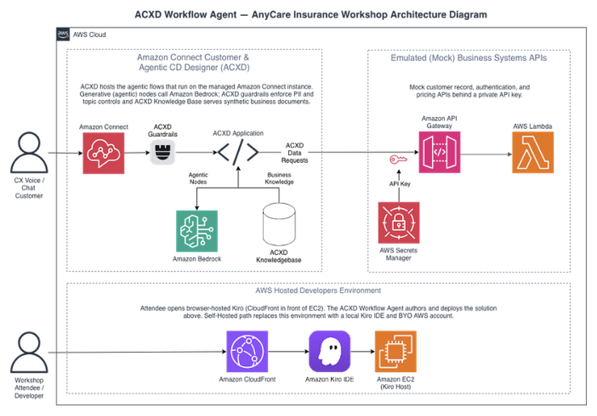
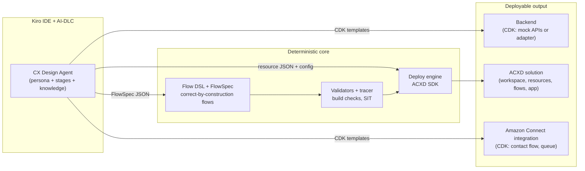
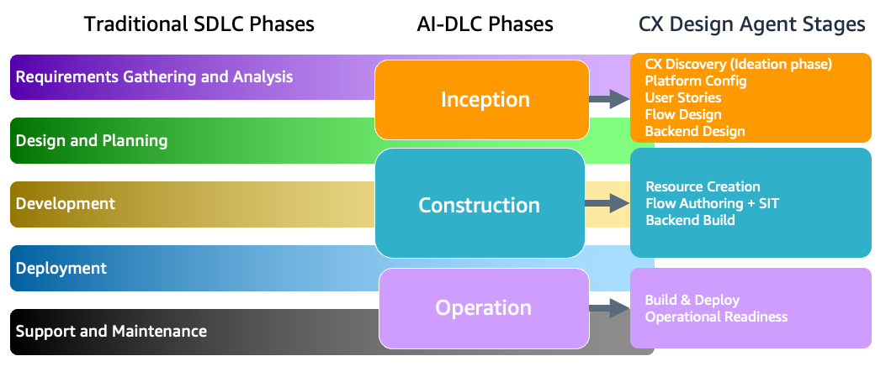
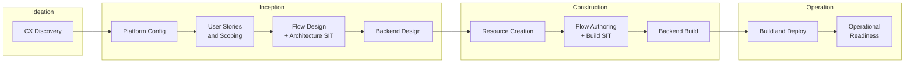

# How the CX Design Agent works

## The plugin and the deterministic core

The agent is an **AI-DLC plugin**. AI-DLC (the AI-Driven Development Lifecycle) supplies the workflow engine: stages,
approval gates, questions and an audit trail. The plugin adds the ACXD-specific stages, a specialist persona, a
curated knowledge base, and the tools that make the output deterministic.

The agent does the open-ended work: understanding the process, designing the conversation, deciding what each flow
does. It hands the exacting work to deterministic tools it authors *for*: a flow-building DSL, a validator and
tracer, and a deploy engine. The result is three sets of deployable code and a runbook.

## The AI-DLC lifecycle

**AI-DLC is a framework for software delivery in a world where AI writes the code.** When writing code costs
little, strict release gates give way to iterative consensus: humans set the direction and approve each stage, AI
produces the designs, code and documents, and every stage leaves a reviewable audit trail. The CX Design Agent
extends that framework for a world where **AI delivers production-ready conversational customer experiences**. It
adds a CX domain expert, agentic CX design patterns, verified platform knowledge and deterministic tooling, so the
same gated lifecycle that builds software now takes a business process to a live conversational agent on Amazon
Connect.

The work runs in **two gated phases**. Each ends with a consolidated document and a human approval.

1. **Scoping.** A guided discovery session with business and technical stakeholders. It works through the business
   process, use cases, integrations and success measures, and produces approved user stories and a consolidated
   scoping document: the business gate before delivery starts.
2. **Design & build.** The agent designs the flows and backend, builds them, tests them against the user stories, and
   produces an architecture document, deployable code and a deployment runbook.

The phases run as **ten stages** (eleven in the enhancement scope), each with its own approval gate:

Component Design is an extra Inception stage used only in the `acxd-enhancement` scope.

**What each stage produces:**

| Stage | Produces |
|---|---|
| CX Discovery | Discovery report, SoP deconstruction, integration inventory and (when generated) the OpenAPI contract |
| Platform Config | Platform configuration (region, models, voice, workspace and application names) |
| User Stories & Scoping | User stories, consolidated scoping document and scoping snapshot |
| Flow Design | Flow architecture, variable map, prompt specs, analytics vocabulary, story trace, Architecture SIT |
| Backend Design | Backend architecture, API specifications, data model |
| Resource Creation | Declarative resource JSON and the deploy config |
| Flow Authoring | FlowSpecs, built flows, Build SIT results |
| Backend Build | The mock API or adapter (CDK) and its synthetic data |
| Build & Deploy | The deployment runbook |
| Operational Readiness | The distribution folder, architecture document and consolidated runbook |

---

[Documentation home](index.md)
