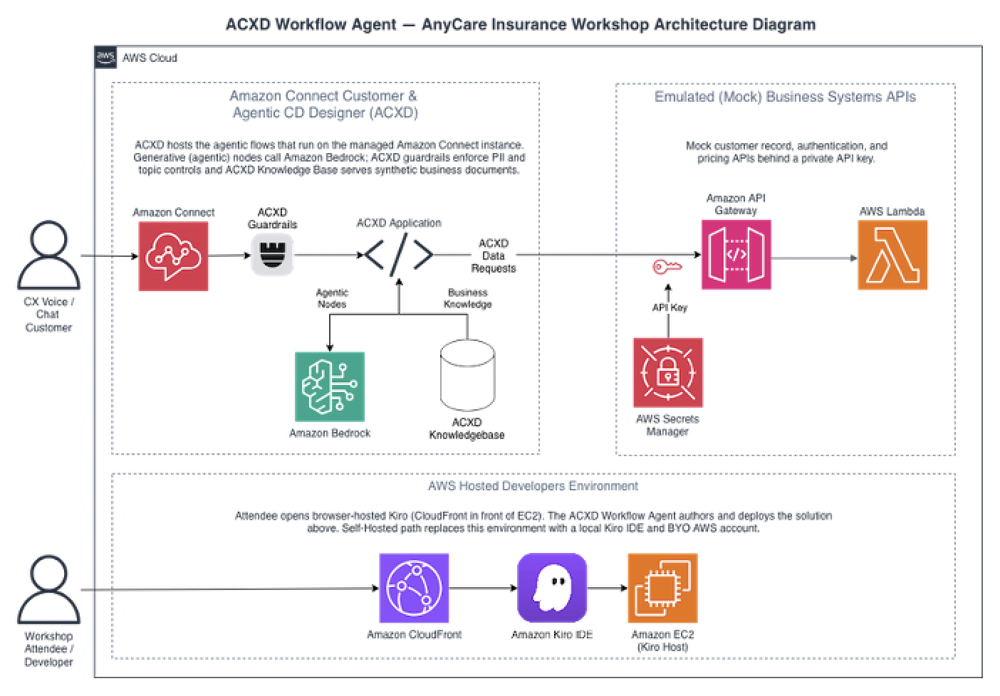

# What is the CX Design Agent?

The **Customer Experience (CX) Design Agent** is an Amazon CX domain expert that runs inside your IDE as an
[AI-DLC](https://github.com/awslabs/aidlc-workflows) plugin. Start from whatever you have: a business process or
standard operating procedure (SoP), user stories, or a plain description of the experience you want. The agent takes
you through discovery, design, build and deployment of a working conversational AI solution on **Amazon Connect
Agentic CX Designer (ACXD)**. You set the direction and approve each step; the agent produces the scoping, the
design, the deployable code and the runbook.

> **Prefer a guided path?** The workshop
> [Customer Experience (CX) Design Agent: From Business Process to Live Conversational CX Agent](https://catalog.us-east-1.prod.workshops.aws/workshops/f130d600-59f4-4059-9eae-4573648d06a2/)
> walks you step by step through installing the agent, running an engagement on a sample business process, and
> deploying and testing the result.

## What you get

- **Agreed scope, fast.** A guided discovery session turns your process, stories or idea into approved user stories
  and a consolidated scoping document for business sign-off.
- **A designed and tested conversation.** Flows, journeys and integrations, checked against every user story before
  anything is deployed.
- **No waiting for data access.** Mock APIs, synthetic data and a synthetic knowledge base let you build and test end
  to end from day one. Swap in your live systems later without redesigning.
- **Deployable code and a runbook.** The ACXD solution, the backend and the Amazon Connect integration, with a
  step-by-step runbook.

Example outputs from the AnyCare Insurance use case are in [`docs/example-outputs/`](../example-outputs/).

---

[Documentation home](index.md)
