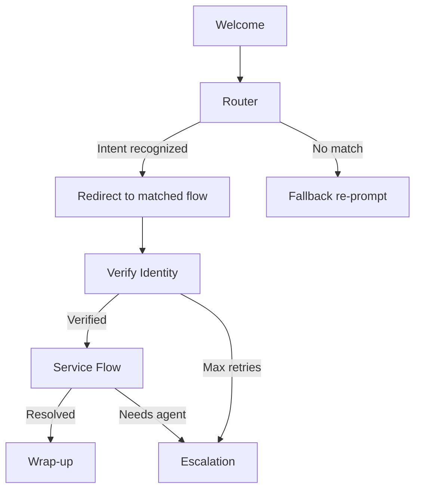

# <Use Case Name>: ACXD Design

<!-- AGENT: This template is populated during Flow Design (Stage 2.75), Component Design (Stage 2.77),
     and Backend Design (Stage 2.78). Replace all <placeholders> with engagement-specific content. -->

## Flow Architecture

<!-- AGENT: One Mermaid diagram per use case showing the flow topology.
     Standard skeleton: Welcome → Router → Verify → Service → Escalation. -->

## Flows

<!-- AGENT: One row per ACXD flow, named in the use-case namespace, with its boundary reason (the flow test it passes). -->

| Flow | Type | Classification | Component? | Description (≤200 chars) |
|------|------|---------------|------------|--------------------------|
| xx-welcome-router | Entry | Deterministic | No | Welcome, intent classify, route to matched flow |
| shared-verify-identity | Auth | Deterministic | Yes | 2-factor auth: account + DOB, 3 retries, escalate |
| xx-<service> | Service | <det/agentic> | No | <description> |
| shared-escalation | Escalation | Deterministic | Yes | Generate summary, transfer to agent |

## Variable Map

<!-- AGENT: All variables across all flows. From Flow Design Stage Step 4. -->

| Variable | Type | Category | Set By | Consumed By | Scope | Sensitive |
|----------|------|----------|--------|-------------|-------|-----------|
| xxAccountId | NLX.AlphaNumeric | Slot | User (capture) | verify-identity | Flow | No |
| xxDateOfBirth | NLX.Date | Slot | User (capture) | verify-identity | Flow | Yes |
| xxVerified | Boolean | Context | verify-identity | All downstream | Session | No |
| xxCustomerId | String | Context | verify-identity | Service flows | Session | No |
| xxCustomerName | String | Context | verify-identity | Service flows | Session | No |
| xxRetryCount | Number | Context | verify-identity | verify-identity | Session | No |
| xxEscalationReason | String | Context | Any flow | escalation | Session | No |

## Generative Journey Prompt Specifications

<!-- AGENT: One spec per Generative Journey node. From Flow Design Stage Step 5. Only for agentic segments. -->

### Generative Journey: xx-<service> / <gj-node-name>

**ROLE:** You are a helpful customer service assistant for AnyCompany.
**CONTEXT:** The customer has been verified. You know their name ({xxCustomerName}) and account ({xxCustomerId}).
**ACTIONS (tools):**
- <tool-1>: <what it does, when to use it>
- <tool-2>: <what it does, when to use it>
**STYLE:**
- Professional and friendly tone
- Voice: keep responses concise and spoken-natural
- Chat: can use formatting and links
- Always confirm before destructive actions
**COMPLIANCE:**
- Never reveal internal system details
- Never fabricate information not returned by tools
- Escalate if customer requests a human agent
- Do not discuss competitors or provide financial advice

## Analytics Tag Vocabulary

<!-- AGENT: From Flow Design Stage Step 6. Every flow must fire at least one tag. -->

| Tag | Category | Flow | Node | KPI Mapped To |
|-----|----------|------|------|---------------|
| completed | Completion | xx-<service> | Success end | Containment rate |
| escalated | Escalation | shared-escalation | N2 TransferMessage | Escalation rate |
| authSuccess | Milestone | shared-verify-identity | N5 AuthSuccess | — |
| authFailed | Failure | shared-verify-identity | N6 RetryOrEscalate | Error rate |
| authMaxRetries | Failure | shared-verify-identity | N7 MaxRetries | Escalation rate |
| noMatch | Friction | Multiple | No-match nodes | Friction rate |

## Metrics Mapping

<!-- AGENT: From Flow Design Stage Step 6b. Explicit link from tags → KPIs → ROI. -->

| Business Metric | Baseline | 30-Day Target | 90-Day Target | Tag Source | Measured In |
|----------------|----------|---------------|---------------|------------|-------------|
| Containment rate | % | +15% | +25% | completed tags ÷ total | ACXD analytics |
| Escalation rate | % | -10% | -20% | escalated tags ÷ total | ACXD analytics |
| AHT | s | -20% | -35% | N/A | Connect metrics |

## Channel Strategy

<!-- AGENT: From Flow Design Stage Step 8. -->

| Aspect | Voice | Chat | Live Sync |
|--------|-------|------|-----------|
| Entry point | Connect contact flow | ACXD widget | Voice+ trigger |
| Special considerations | SSML for IDs, barge-in | Rich cards, quick replies | Forms for data capture |
| Escalation path | Transfer to queue | Transfer to queue | End Live Sync + transfer |

## Flow Hand-off Contracts

<!-- AGENT: One row per Redirect: the context variables the target flow reads, set before the Redirect. -->

| From flow | To flow | Context set before Redirect | Why separate (flow test passed) |
|-----------|---------|-----------------------------|------------------------------------|
| <flow> | <flow> | <vars> | <reason> |

## Backend Architecture

<!-- AGENT: From Backend Design Stage. Pattern A or B per data request. CDK stack. -->

| Data Request | Pattern | Endpoint | Backend Service |
|-------------|---------|----------|----------------|
| verifyIdentity | A (Direct) | POST /verify-identity | CRM API |
| <name> | <A/B> | <endpoint> | <service> |

**IaC:** Single CDK stack per use case. See `backend/stack.ts`.
